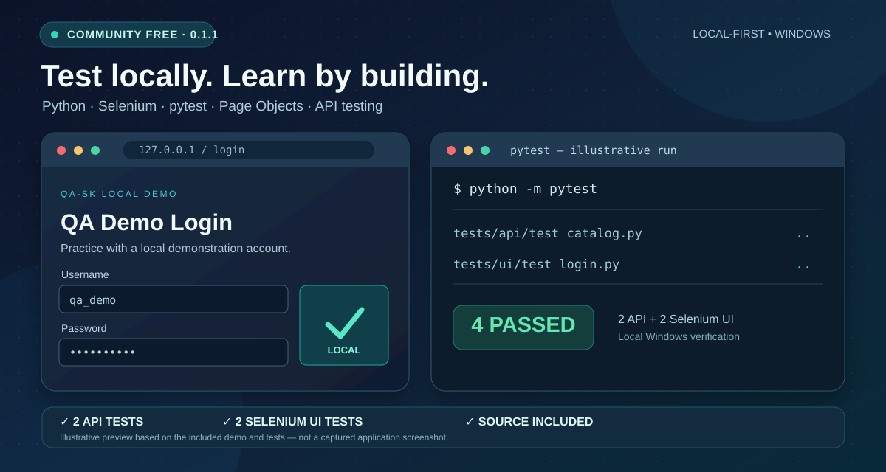
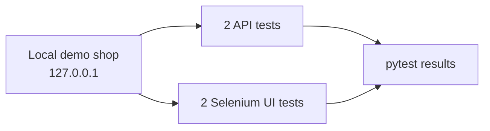

<p align="center">
  
</p>

<h1 align="center">QA Automation Starter Kit</h1>
<h3 align="center">Community Free · v0.1.1</h3>

<p align="center">
  <strong>Learn Python test automation with a real, runnable local project.</strong><br />
  Selenium UI tests · API checks · Page Objects · pytest · Windows
</p>

<p align="center">
  <a href="releases/qa-automation-starter-kit-free-v0.1.1.zip"></a>
  <a href="free-v0.1.1/"></a>
  <a href="https://buymeacoffee.com/sebagutierrezf"></a>
</p>

<p align="center">
  
  
  
  
  
  <a href="LICENSE"></a>
</p>

<p align="center">
  <a href="#-features">Features</a> ·
  <a href="#-download--installation">Installation</a> ·
  <a href="#-how-it-works">How it works</a> ·
  <a href="#-free-vs-pro">Free vs Pro</a> ·
  <a href="#-support-the-project">Support</a>
</p>

---

## 🖼️ Preview

<p align="center">
  <a href="docs/assets/free-preview.svg"></a>
</p>

> **Illustrative preview, not an application screenshot.** It represents the included local login demo and 2 API + 2 Selenium UI examples; no production dashboard or hosted service is provided.

## ✨ Features

A **free, MIT-licensed Python QA automation starter kit** built for hands-on learning, experimenting, and portfolio practice. It runs against an included local demo shop rather than a real website or production service.

| 🧪 API testing | 🌐 Browser automation |
|:--|:--|
| **2 runnable API tests** covering the local shop's catalog endpoints, with a reusable API client. | **2 runnable Selenium UI tests** using ChromeDriver and a small Page Object example. |

| 🧱 Beginner-friendly structure | 🔐 Local-first execution |
|:--|:--|
| Python source, test fixtures, a demo server, PowerShell setup and verification tools. | The demo binds to **`127.0.0.1`**. No external website, real account or production credentials are required. |

## 🔍 At a glance



**Verified locally on Windows:** 2 API examples and 2 UI examples (4 total). There is no hosted demo or CI badge claiming an automatic build.

## 📦 Download & installation

**[⬇ Download the certified Free v0.1.1 ZIP](releases/qa-automation-starter-kit-free-v0.1.1.zip)**

1. Download and fully extract the ZIP.
2. Open PowerShell in the **extracted package folder**.
3. Provide the required dependencies and the path to your compatible ChromeDriver.
4. Run the scripts below.

**Requirements:** Windows 10/11, PowerShell, Python 3.12, pytest **8.3.4**, Selenium **4.28.1**, Chrome, and a compatible ChromeDriver.

> [!IMPORTANT]
> Chrome, ChromeDriver, Python packages and wheels are **not bundled**. The offline installer does **not** download missing dependencies. You need an existing compatible Python environment or a complete local `wheelhouse/`. Consult the [package README](free-v0.1.1/README.md) before setup.

```powershell
# Replace this path with your installed, compatible chromedriver.exe:
$env:CHROMEDRIVER_PATH = 'C:\your-tools\chromedriver.exe'

powershell.exe -NoProfile -ExecutionPolicy Bypass -File .\tools\setup_offline.ps1
powershell.exe -NoProfile -ExecutionPolicy Bypass -File .\tools\verify_api.ps1
powershell.exe -NoProfile -ExecutionPolicy Bypass -File .\tools\verify_free.ps1
```

Expected with all prerequisites installed: **2 API passes** and **4 passes in the full suite**. Missing prerequisites fail visibly instead of triggering downloads or silently skipping browser tests.

<details>
<summary><strong>🔎 Verify the original ZIP checksum</strong></summary>

SHA-256:

```text
f88f82e98db0de6c7cc290205ee3e132f5388fcd6b23d6a1a5111767b32b1646
```

On Windows:

```powershell
Get-FileHash .\qa-automation-starter-kit-free-v0.1.1.zip -Algorithm SHA256
```

The [browseable source snapshot](free-v0.1.1/) is unchanged from the certified original, including its manifest and historical alpha README. The repository's presentation README can improve independently without modifying that snapshot.

</details>

## 🧭 How it works

| Component | Purpose |
|:--|:--|
| [`demo_shop/`](free-v0.1.1/demo_shop/) | Local HTTP shop used only for test practice |
| [`src/qa_starter/`](free-v0.1.1/src/qa_starter/) | API client, browser helper and Page Object example |
| [`tests/api/`](free-v0.1.1/tests/api/) | Two local API checks |
| [`tests/ui/`](free-v0.1.1/tests/ui/) | Two Selenium browser checks |
| [`tools/`](free-v0.1.1/tools/) | Windows offline setup and verification scripts |

## 🚀 Free vs Pro

| | Community Free | Professional Pro |
|:--|:--:|:--:|
| Local API and browser examples | 4 | 16 Pro examples + 2 local Helpdesk examples |
| Page Object approach | Basic example | Expanded framework |
| HTML and JUnit reporting | Not included as a Pro reporting package | Included |
| Full source code | ✅ | ✅ |
| Availability | **Free download now** | Separate commercial edition; public checkout pending store approval |

Pro is a separate, proprietary package. No live payment link is published while its storefront approval is pending.

## 🔒 Safety, privacy & license

- Designed for **local educational use** against `127.0.0.1`; it is **not** a hosted QA service or a ready-to-use integration for arbitrary websites.
- Do not put production credentials, sensitive customer data or unauthorized sites into the example tests.
- Free source code is published under the **[MIT License](LICENSE)**.
- Python dependencies are distributed separately under their own licenses; see [third-party notices](free-v0.1.1/THIRD_PARTY_NOTICES.md).

## ☕ Support the project

If this Free kit is useful, you can **star the repository**, share it with another QA learner, or optionally support future development.

<p align="center">
  <a href="https://buymeacoffee.com/sebagutierrezf"></a>
</p>

Donations are entirely voluntary; **Free remains free** and no payment is required to download or use it.

---

<details>
<summary><strong>🇨🇱 Resumen en español</strong></summary>

**QA Automation Starter Kit Free v0.1.1** es un proyecto gratuito de aprendizaje de automatización con Python. Incluye **2 pruebas API y 2 pruebas UI con Selenium**, un servidor local de demostración y ejemplos de Page Objects.

Descarga el [ZIP certificado](releases/qa-automation-starter-kit-free-v0.1.1.zip), descomprímelo y sigue las instrucciones de [instalación](free-v0.1.1/README.md). Requiere Windows, Python, Chrome/ChromeDriver y dependencias previamente disponibles; **no las descarga automáticamente**.

El código Free usa licencia MIT. Si quieres apoyar voluntariamente su desarrollo, puedes hacerlo mediante [Buy Me a Coffee](https://buymeacoffee.com/sebagutierrezf).

</details>

<p align="center"><sub>Made for QA learners by <a href="https://github.com/SebaGutierrezF">SebaGutierrezF</a> · Community Free v0.1.1</sub></p>
